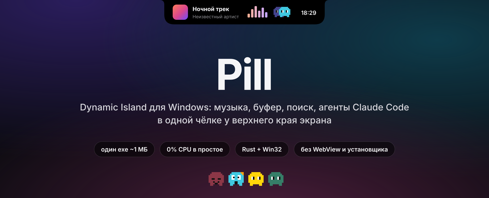
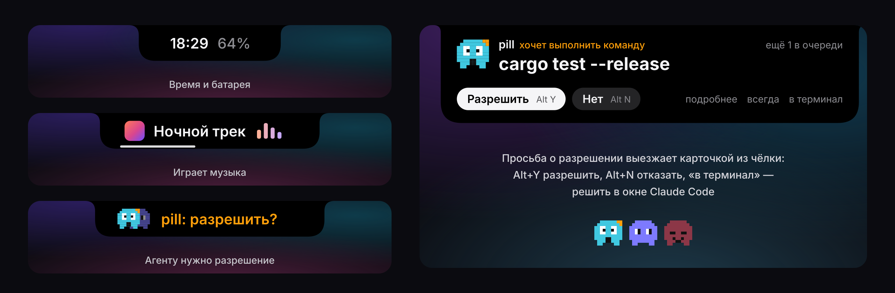
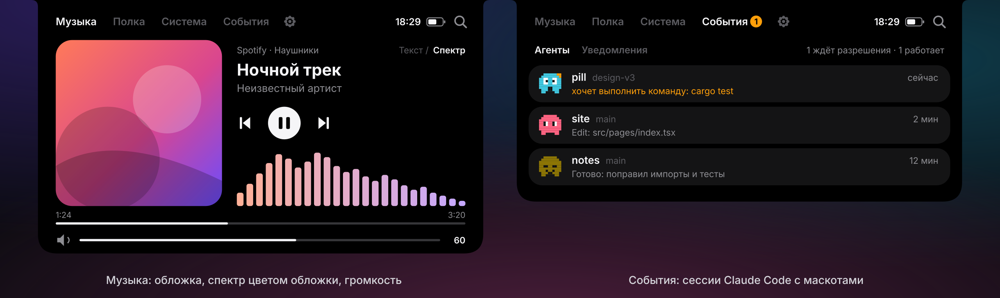

<p align="center">
  
</p>

<p align="center">
  
  
  
  
</p>

**Pill** — чёрная «чёлка» у верхнего края экрана, как Dynamic Island на айфоне, только для Windows. Наводишь курсор, и она раскрывается в панель с музыкой, файлами, переключателями, монитором системы и статусом агентов Claude Code. Убираешь курсор, и она снова сворачивается в маленькую пилюлю со временем.

Делал её потому, что похожие программы на WebView съедали под гигабайт памяти и ~16% ядра в простое. Pill написана на чистом Win32 и в простое не тратит процессор совсем.

- **Один `.exe`, около 1 МБ.** Ни установщика, ни DLL рядом: скопировал и запустил.
- **Почти 0% CPU в простое.** Всё работает по системным событиям, никаких опросов раз в 16 мс. Исключения: спектр, пока играет музыка (~0,3% ядра), и проверка уведомлений раз в 2 с.
- **Около 30 МБ памяти** свёрнутой, до 45 МБ в раскрытой.

## Как выглядит

<p align="center">
  
</p>

<p align="center">
  
</p>

## Что умеет

**Свёрнутая пилюля**

- Время и заряд батареи (на ПК без батареи только время).
- Что играет: мини-обложка, 4 полоски спектра, прогресс трека.
- Громкость и яркость полоской прямо в пилюле вместо системного окна.
- Точка, когда микрофон или камера заняты, с именем программы.
- Прогресс задач твоих скриптов («Рендер 45%»), маскоты работающих агентов, счётчик пропущенных уведомлений.
- Сама прячется в полноэкранных играх и видео. `Ctrl+Alt+H` спрятать или вернуть вручную.

**Музыка.** Любой плеер, который показывается в системных медиа-кнопках (Spotify, Яндекс Музыка в браузере, YouTube и т. д.): обложка, пауза, перемотка, громкость, спектр цветом обложки.

**Полка.** Кидаешь файлы на пилюлю, они лежат на полке (до 8 штук, с миниатюрами), потом вытаскиваешь в любое окно: в Telegram, браузер, папку. Хранится только путь, файл никуда не копируется.

**Система**

- Переключатели: Wi-Fi (с именем сети), Bluetooth, VPN, тёмная тема, звук, микрофон, яркость.
- Питание: блокировка, сон, перезагрузка, выключение (с подтверждением).
- Монитор: ЦП, память, видеокарта, сеть, диск, самые прожорливые программы. Предупреждение, если что-то держит ЦП или память под 90% полминуты.

**Поиск** (`Alt+Space`)

- Программы из меню Пуск, частые сверху.
- Калькулятор: `200*15%`, `(1,5+0.5)*4`.
- Таймеры: `таймер 5м`, `1ч30м`, `t 10`.
- `> команда` выполнить в cmd.
- История буфера обмена (`Ctrl+Alt+V`): поиск, закрепление, вставка по Enter. Записи, которые менеджер паролей помечает как секретные, в историю не попадают.

**События**

- **Агенты Claude Code.** Видно, какие сессии работают, какие закончили и какой нужно разрешение. Просьба о разрешении выезжает карточкой: `Alt+Y` разрешить, `Alt+N` отказать, «в терминал» — ответить в окне Claude Code. На вопросы агента с вариантами можно отвечать `Alt+1…4`. У каждого проекта свой пиксельный маскот.
- **Уведомления Windows** (Telegram и прочие) карточкой из чёлки, сгруппированные по чатам. Кнопка «тишина на час» и тихие часы 23:00–8:00. Системные баннеры Windows Pill может спрятать сама, сообщения останутся только в чёлке.

## Установка

1. Скачай `pill.exe` из [Releases](../../releases) (или собери сам, см. ниже).
2. Запусти. Пилюля появится сверху по центру, значок в трее.
3. В трее или по шестерёнке в панели есть **Настройки**: автозапуск, задержка сворачивания, звуки, тихие часы.

> Exe не подписан, поэтому Windows SmartScreen может предупредить при первом запуске: «Подробнее» → «Выполнить в любом случае».

**Подключить Claude Code:** Настройки → Агенты → «Установить». Pill сама добавит хуки в `~/.claude/settings.json` (свои записи, чужие не трогает, старый файл сохранит в `settings.json.pill-backup`). Убираются там же одной кнопкой.

**Показывать уведомления Windows:** Настройки → Уведомления → дать доступ. Чтобы не было двойных баннеров, включи там же «Прятать баннеры Windows»: Pill выключит баннеры у программ, а в центре уведомлений сообщения останутся, Pill читает их оттуда. Главный переключатель «Уведомления» в Параметрах Windows должен быть включён. Telegram Desktop показывает свои окошки вместо системных уведомлений, пока в его настройках не включены уведомления Windows.

**Обновления:** Настройки → О программе → «Проверить». Pill спросит GitHub о последнем релизе и по кнопке «Обновить» скачает новый `pill.exe`, сверит SHA-256 и перезапустится. Если новая версия не запустится, вернёт прежнюю. Сама в фоне ничего не проверяет.

## Горячие клавиши

| Клавиши | Что делают |
|---|---|
| `Alt+Space` | поиск (если занято, `Ctrl+Alt+Space`) |
| `Ctrl+Alt+V` | история буфера обмена |
| `Ctrl+Alt+H` | спрятать или вернуть пилюлю |
| `Alt+Y` / `Alt+N` | разрешить / отказать агенту, пока карточка на экране |
| `Alt+T` | ответить в терминале |
| `Alt+1…4` | вариант ответа на вопрос агента |
| в поиске: `Tab`, `Alt+1…9`, `Ctrl+P`, `Del` | режим, запуск по номеру, закрепить, удалить запись буфера |

Клавиши ответа агенту работают только пока карточка с просьбой видна на экране и не раньше чем через полсекунды после её появления. «Всегда разрешать» только кликом в «подробнее»: там видно, какое правило добавится.

## Свои скрипты → пилюля

Pill слушает `127.0.0.1:47821` (только этот компьютер; запросы из браузера отклоняются). Нужен ключ: Настройки → Агенты → «Скопировать ключ». Передавай его заголовком `X-Pill-Key` или параметром `key=`, без ключа ответ 403. Любой скрипт может показать надпись или прогресс:

```powershell
$K = "ключ из настроек"

# надпись на 5 секунд
curl -H "X-Pill-Key: $K" "http://127.0.0.1:47821/notify?text=Render%20done&secs=5"

# задача с прогрессом в свёрнутой пилюле
curl -H "X-Pill-Key: $K" -d "id=render&title=Render&progress=45" http://127.0.0.1:47821/task
curl -H "X-Pill-Key: $K" "http://127.0.0.1:47821/task?id=render&state=done"     # или state=error

# статус любого своего агента: work | ask | wait | done | gone
curl -H "X-Pill-Key: $K" "http://127.0.0.1:47821/agent?id=bot1&name=mybot&state=work&text=parsing"
```

Кириллицу удобнее слать через `curl --data-urlencode "text=Готово"`. `/ping` отвечает `pill` и ключа не требует.

## Сборка из исходников

Нужен [Rust](https://rustup.rs) (проект собирается тулчейном `stable-x86_64-pc-windows-gnu`, Visual Studio не нужна).

```powershell
git clone https://github.com/Umadzura/pill
cd pill
cargo build --release
# готово: target\release\pill.exe
cargo test --release
```

Зависимость одна — крейт [`windows`](https://crates.io/crates/windows).

## Где лежат данные

Всё в `%APPDATA%\Pill`:

| Файл | Что в нём |
|---|---|
| `settings.txt` | настройки |
| `clipboard.txt` | история буфера (до 100 записей + закреплённые), **открытым текстом**; в Настройки → Панель можно держать её только в памяти |
| `shelf.txt` | пути файлов на полке |
| `launches.txt` | сколько раз запускал программы из поиска |
| `banners.txt` | у каких программ Pill выключила баннеры Windows (чтобы вернуть их) |
| `crash.log` | след, если программа упала |

Снимки экрана из «Ножниц» лежат в `%LOCALAPPDATA%\Pill\snips` (20 последних).

Удалишь папку, и всё сбросится. В интернет Pill ходит только по кнопке «Проверить» обновление: один запрос к GitHub.

## Статус

Первая публичная версия. Основное проверено на ПК. Что пока проверено слабо: яркость на ноутбуках, несколько видеокарт, сетевые диски на полке. Нашёл баг — открывай [issue](../../issues).
